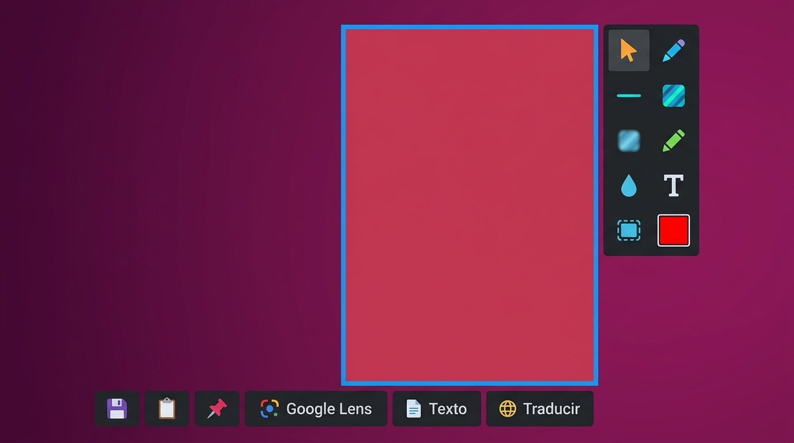
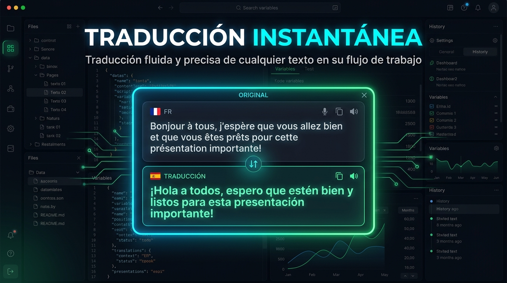
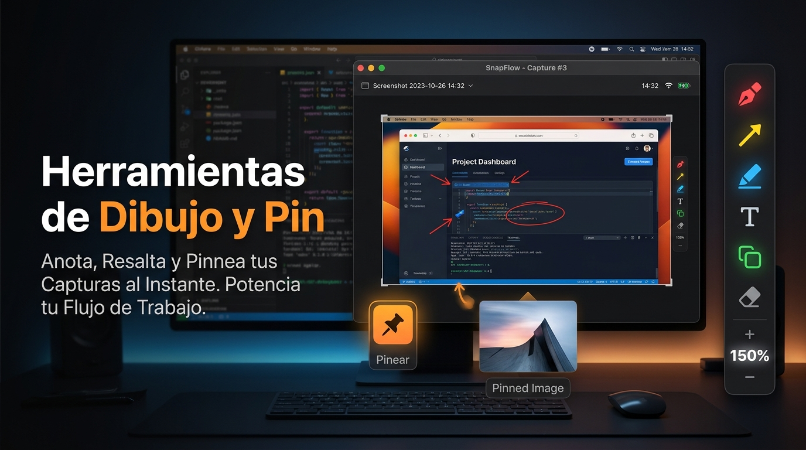
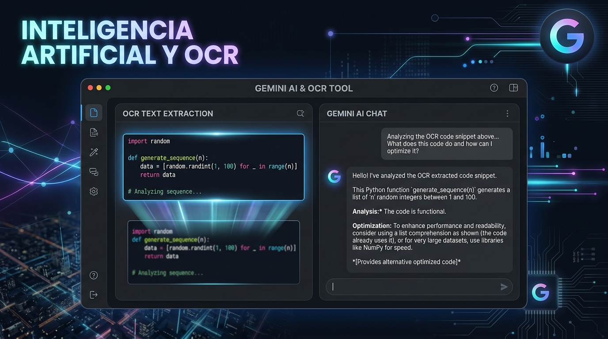

# 🔍 LensCapture

  **The AI-Powered Snipping Tool for Windows**  
  *Instant Google Lens Visual Search • Google Gemini OCR • Real-Time Screen Translation • Floating Pins*

  
  
  
  
  
  

   

  
  &nbsp;&nbsp;
  

    
  [English](#-overview-english) • [Español](#-descripción-general-español) • [Features](#-features--características) • [Installation](#-quick-install--instalación) • [Architecture](#-architecture--arquitectura-del-código)

    

  

---

## 🌐 Overview (English)

**LensCapture** is a modern, lightweight screen capture and productivity tool for Windows built with Python and PyQt6. It upgrades the traditional snipping experience with cutting-edge AI:

- 🔍 **Google Lens Integration:** Send any snippet directly to Google Lens for visual matching, shopping lookups, and reverse image searches.
- 🤖 **Google Gemini AI OCR & Translation:** Extract text from anywhere on your screen and translate it instantly with Markdown-formatted output.
- 📌 **Always-on-Top Floating Pins:** Keep screenshots pinned above other windows while coding, designing, or studying.
- ⚡ **Background Tray & Low-Latency Hotkeys:** Seamless global hotkey integration that avoids UAC prompts and replaces standard tools smoothly.

---

## 🇪🇸 Descripción General (Español)

**LensCapture** es una herramienta de captura de pantalla y productividad para Windows construida con Python y PyQt6. Añade superpoderes de Inteligencia Artificial a la experiencia tradicional de recortes:

- 🔍 **Búsqueda con Google Lens:** Sube cualquier recorte para encontrar productos, imágenes similares y fuentes originales en segundos.
- 🤖 **OCR y Traducción con Gemini:** Extrae texto con precisión milimétrica y tradúcelo en tiempo real a tu idioma con formato Markdown.
- 📌 **Fijar en Pantalla (Pin):** Mantén referencias flotantes encima de cualquier ventana mientras trabajas.
- ⚡ **Bandeja del Sistema y Atajo Global:** Accesible en cualquier momento con Print Screen o la tecla que elijas, sin avisos molestos de UAC al inicio.

---

## 🚀 Features / Características

  
  
<em>Real-Time AI Translation & Extraction / Traducción y Extracción con IA</em>

   
  
  
<em>Drawing Tools & Floating Pin / Herramientas de Dibujo y Fijado en Pantalla</em>

   
  
  
<em>Gemini AI OCR with Markdown Output / OCR con Gemini y salida en Markdown</em>

| Feature | Description (EN) | Descripción (ES) |
|---|---|---|
| 📸 **Screen Capture** | Global hotkey (Print Screen or custom) with pixel-accurate selection. | Atajo global configurable con selección precisa de área. |
| 🎨 **Annotation Suite** | Pen, highlighter, arrows, rectangles, blur brush, custom text, and color palette. | Lápiz, resaltador, flechas, rectángulos, desenfoque, texto y colores. |
| 🔍 **Google Lens** | Instant reverse visual search on Google Lens with automatic Imgur temporary upload. | Búsqueda visual directa en Google Lens subiendo la imagen temporalmente. |
| 🤖 **Gemini AI OCR** | High-precision text extraction from images with structured Markdown display. | Extracción de texto inteligente con renderizado en Markdown legible. |
| 🌐 **Live Translation** | Translate foreign language on screen into your native language instantly. | Traduce cualquier texto visible en pantalla a tu idioma preferido. |
| 📌 **Pin to Screen** | Frameless, draggable, always-on-top window to keep reference snippets visible. | Ventanas flotantes sin bordes para fijar recortes sobre tus programas. |
| ⚡ **Fast Mode** | Automatically extracts/translates as soon as you release the mouse button. | Procesa y traduce el área al soltar el ratón sin pasos intermedios. |
| 🛡️ **Zero UAC Auto-Start** | Windows Task Scheduler (schtasks) integration to run seamlessly at login. | Auto-inicio silencioso al encender Windows sin alertas de administrador. |

---

## 📥 Quick Install / Instalación

### Option 1: Installer Executable (Recommended)
1. Download **[Instalador_LensCapture.exe](https://github.com/eygelias/LensCapture/releases/latest)**.
2. Run the installer wizard. It will place the files into %LOCALAPPDATA%\LensCapture, create Desktop & Start Menu shortcuts, and launch the app in the background.

### Option 2: Portable Version
1. Download **[LensCapture-Portable.zip](https://github.com/eygelias/LensCapture/releases/latest)**.
2. Extract the folder and run LensCapture.exe. No installation required!

---

## 🛠️ Developer Setup / Configuración para Desarrolladores

If you want to clone, modify, or contribute to LensCapture:

### 1. Clone Repository
`ash
git clone https://github.com/eygelias/LensCapture.git
cd LensCapture
`

### 2. Install Dependencies
`ash
pip install -r requirements.txt
`

### 3. Run Application
`ash
python app.py
`

---

## 📦 Build Executable (PyInstaller)

To build your own installer or standalone executable, use the provided uild.bat script or run:

### Step 1: Build Core Application (onedir)
`ash
pyinstaller --noconfirm --clean --onedir --windowed --name "LensCapture" --icon "icon.ico" --hidden-import imgur_client --add-data "icon.ico;." app.py
`

### Step 2: Build Installer Wizard (onefile)
`ash
pyinstaller --noconfirm --clean --onefile --windowed --name "Instalador_LensCapture" --icon "icon.ico" --uac-admin --add-data "icon.ico;." --add-data "dist/LensCapture;LensCapture" installer_wizard.py
`
The output file will be generated in dist/Instalador_LensCapture.exe.

---

## 🧠 Architecture / Arquitectura del Código

LensCapture is structured in modular components:

1. **pp.py**: Application entry point. Controls the System Tray icon, registers low-level Windows keyboard hooks, and orchestrates main workflows.
2. **capture.py**: Visual capture engine. Creates a full-screen transparent, borderless overlay (Qt.WindowStaysOnTopHint), manages mouse drag selection, and renders drawing canvas tools.
3. **main_window.py**: Settings dashboard. Allows remapping hotkeys, configuring Gemini API keys, language selections, and managing Task Scheduler auto-start.
4. **config.py**: Local persistent configuration manager (%APPDATA%\LensCapture\config.json).
5. **gemini_client.py**: Integration with Google Gemini API (google-genai) for OCR extraction and real-time translation.
6. **imgur_client.py**: Ephemeral image uploader creating public endpoints required by Google Lens search queries.
7. **
esult_window.py**: Markdown viewer window for AI text responses and translations with copy-to-clipboard functionality.
8. **pin_window.py**: Frameless, draggable, always-on-top window display for pinned snippets.
9. **installer_wizard.py**: Custom deployment wizard extracting packaged binaries, generating Windows shell shortcuts, and setting up initial execution.

---

## 🤝 Contributing & Community

Contributions, issues, and feature suggestions are always welcome!
- 🌟 **Star this repository** if you find it helpful!
- 🐛 **Found a bug?** Open an [Issue](https://github.com/eygelias/LensCapture/issues).
- 💡 **Have an idea?** Start a discussion or submit a Pull Request.

---

## 📄 License

This project is licensed under the **MIT License** - see the [LICENSE](LICENSE) file for details.